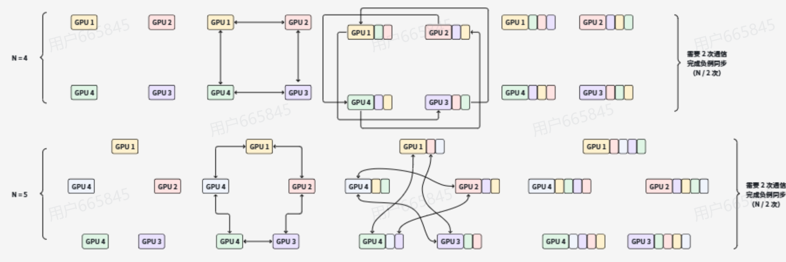
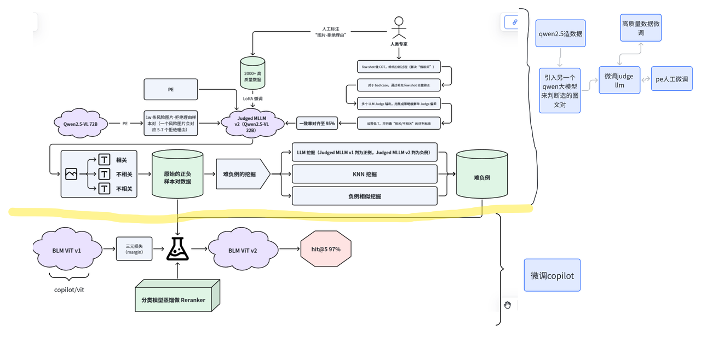

# 视觉预训练与 Copilot：动态分辨率、负例同步和细粒度对齐

一个视觉编码器可以同时服务多模态大模型和图搜文检索。但从固定分辨率训练迁移到真实业务数据后，问题会逐层出现：图片细节被压缩、视觉 token 长度不一致、GPU 负载不均、跨卡样本数不同，以及全局表征难以区分局部属性。

这篇文章整理这些问题之间的关系，并连接到 Copilot 后训练：如何把审核反馈变成更有价值的检索样本。原始材料包含口述记录、问答和方案讨论，以下按工程问题重组。

## 动态分辨率：保留细节，同时控制预算

固定尺寸预处理可能压缩小物体、文字或局部纹理。动态分辨率让不同图片使用不同数量的视觉 token，但仍然需要限制输入像素与 token 总量。

Smart Resize 的任务是尽量保持纵横比，并把尺寸调整到模型要求的粒度，同时满足最小和最大像素预算。它仍然执行 resize，因此不应理解成“完全不缩放”或“信息无损”。

### 区分 patch 与合并后的 token

以 Qwen2.5-VL-7B 的配置为例，视觉 patch size 为 14，spatial merge size 为 2。尺寸对齐中常见的 28 来自二者的组合，而不是说最初的 patch embedding 一定使用 28×28 的卷积核。参见 [官方模型配置](https://huggingface.co/Qwen/Qwen2.5-VL-7B-Instruct/blob/main/config.json)。

对一张高 H、宽 W 的图片，在尺寸满足对齐要求的简化情况下：

```text
ViT 内的空间 patch 数 ≈ (H / 14) × (W / 14)
空间合并后的 token 数 ≈ (H / 28) × (W / 28)
```

两者服务不同计算阶段。设计 BinPack 时，必须说明预算对应的是哪一层的 token；不能将合并后的数量直接当作 ViT 内部的注意力计算量。

## Window Attention 与 Window Index

对 N 个 token 做全局自注意力，注意力矩阵规模随 N² 增长。窗口注意力将大部分交互限制在局部区域，再通过部分全局注意力层连接不同区域。

Window Index 解决的是序列组织问题。图像按行展开后，空间上属于同一窗口的 token 不一定在序列中相邻。

```text
原始 4×4 patch 网格：
 0   1   2   3
 4   5   6   7
 8   9  10  11
12  13  14  15

按 2×2 窗口分组：
窗口 0：[0, 1, 4, 5]
窗口 1：[2, 3, 6, 7]
窗口 2：[8, 9, 12, 13]
窗口 3：[10, 11, 14, 15]

窗口顺序：
[0, 1, 4, 5, 2, 3, 6, 7, 8, 9, 12, 13, 10, 11, 14, 15]
```

窗口重排使同组 token 能够交给相应的分组注意力实现。对应的位置坐标、旋转位置编码索引或相关元数据也必须同步重排，否则特征会和错误的位置配对。需要恢复原始顺序时，还应保存逆置换。

图像位置包含行列信息，视频还包含时间维度。不同模块的具体编码形式应以实现为准，不能把所有位置编码都理解为直接向 token 相加一个三维向量。

## BinPack：按 token 预算组织 batch

动态分辨率下，相同图片数不再意味着相同计算量。一个 batch 可能包含许多低分辨率图片，另一个则包含少量高分辨率图片。只按样本数分组容易造成吞吐波动与 padding 浪费。

BinPack 的思路是为每个 bin 设定 token 预算，将若干完整样本放入其中，使总长度尽量接近预算。

```text
预算：4096 token
样本长度：[1024, 512, 256, 2048, 768]

bin 1：[2048, 1024, 512, 256] → 3840 token
bin 2：[768]                  → 768 token
```

这是装箱示例，不是最优解保证。实际数据需要保留图像、文本和样本边界的对应关系；不同图片放入同一个 bin，也不意味着它们应当互相做注意力。

### 离线装箱

对于相对稳定的大规模开源数据，先计算长度，再在文件准备阶段装箱并封装为 tar：

1. 对数据做全局 shuffle，减少原始顺序带来的分布偏差。
2. 在较小的数据块内执行装箱，避免对整个大数据集一次求解。
3. 保存图文对、长度和样本边界等元数据。
4. 训练时由 DataLoader 读取已组织好的样本。

局部装箱是在处理成本与填充率之间做取舍。原笔记把装箱和背包问题联系起来，但不应将所有装箱实现的复杂度写成统一的 O(n²)；复杂度取决于采用的启发式、排序和数据结构。

### 在线装箱

对于持续增长的业务数据，可以在 DataLoader 中按流式方式填充 bin。若单个样本长度有明确上限，顺序装箱的尾部浪费就更容易约束。

原笔记用 392×224 的图像、28 的有效空间粒度举例：单样本对应 14×8＝112 个合并后 token。对于 4096 的预算，112/4096 约为 2.73%。这是特定计数口径下的上界示意，不能与 ViT 原始 patch 数混用。

## 为什么 token 预算相同，跨卡张量仍然不同

CLIP 式对比学习通常会为每张图片、每条文本输出一个 embedding。不同 GPU 即使处理了接近数量的视觉 token，包含的图片数量仍可能不同。

```text
GPU 0：3 张较大图片 → 图像特征形状 [3, d]
GPU 1：6 张较小图片 → 图像特征形状 [6, d]
```

跨卡同步的是样本 embedding 时，影响接收缓冲区大小的是第一维的样本数，而不是前面的视觉 token 总预算。

一种处理方式是先同步各卡样本数，再根据长度分配缓冲区，使用可变长通信或 padding 后再裁剪。图文正例索引也必须依据真实长度计算，不能继续假设每卡都有相同 batch size。

## 负例同步、DDP 与 Bidir

跨卡交换特征可以扩大当前对比学习中的候选池。例如 8 张卡各有 3 对图文，单卡只有 2 个其他文本候选；合并当前所有卡的特征后，每个图像可以和其余 23 条文本比较。

要区分三件事：

| 机制 | 作用 |
| --- | --- |
| DDP 的梯度同步 | 让各副本共同更新同一个模型 |
| All-Gather 或点对点特征交换 | 扩大当前损失计算可见的特征集合 |
| 梯度累积 | 多个 microbatch 计算梯度后，再执行一次参数更新 |

**普通梯度累积不会自动扩大每次 CLIP 损失的负例池。**如果希望跨 microbatch 共享负例，需要额外的特征缓存、重计算或相应损失实现。DDP 也不会自动帮任意 CLIP 训练代码收集样本 embedding。可参考 [PyTorch DDP 文档](https://docs.pytorch.org/docs/stable/generated/torch.nn.parallel.DistributedDataParallel.html)。

原方案使用双向通信 Bidir，让特征同时向两个方向传播，减少单向传播中的等待。实现时需要处理奇偶卡数、重复特征、通信顺序以及梯度路径。



*图：原始笔记中的通信流程对比，具体性能取决于硬件拓扑与通信实现。*

项目记录中，负例同步带来的额外训练耗时由约 40% 降到约 10%。这里表示相对于未做负例同步基线的额外耗时，不是训练总时间减少了 30%，也不是所有硬件上都成立的加速比例。

## 动态视频帧与序列边界

固定抽取少量视频帧可能错过短暂事件；保留更多帧又会增加计算开销。原方案讨论根据帧数和 token 总预算组织可变长视频，而不是把所有视频补到同一长度。

在这种设计中，需要区分三个层级：

- 帧内局部与全局交互，用于处理空间细节。
- 同一视频内的跨帧交互，用于处理时间关联。
- 不同视频之间的边界，避免互不相关的样本相互注意。

使用变长注意力实现时，可通过累计序列长度 `cu_seqlens` 指定独立序列的边界。例如长度 `[26, 40, 18]` 对应累计边界 `[0, 26, 66, 84]`。在帧内计算和视频内计算阶段，应分别使用与该层级一致的边界。

这里是原笔记讨论的扩展方案，不应直接当作所有 Qwen2.5-VL 实现的默认视频结构。动态帧数也不意味着可以无预算地输入每一帧。

### 池化与长文本

图像或视频编码后，可通过平均池化得到固定维度的 embedding。注意力池化是另一种选择，但需要单独验证计算成本与效果。池化时应排除 padding，区分按帧平均和按全部 token 平均。

原笔记还使用 BERT / BGE 文本编码器，并针对所用配置的 512 token 限制进行分段编码，再聚合各段表征。这个限制属于具体模型配置，不能推广到所有 BGE 模型。分段时还需要预留特殊 token 的空间。

## FG-CLIP 式细粒度图文对齐

全局图文相似度可能无法充分区分局部属性：图片里是白猫还是黑猫、某一区域是纹身还是伤痕，都会影响细粒度判断。

原方案参考 FG-CLIP v1，把训练目标分为全局对齐、区域对齐和难负例区分。参见 [FG-CLIP 项目](https://github.com/360CVGroup/FG-CLIP)。

### 全局、区域与难负例

全局目标比较整图与描述；区域目标比较局部图像与对应短语；难负例目标让模型区分语义接近但属性或动作不符的描述。

数据准备流程包括：

1. 为图像补充完整 Caption，避免只有一个过短的审核标签。
2. 从 Caption 提取实体或短语，并用目标检测器获得候选区域。
3. 用已有对齐模型计算区域与短语的相似度，自举生成局部图文对。
4. 保留主要对象，修改颜色、属性或动作，生成候选难负例。
5. 质量检查，防止把实际也正确的描述误当作负例。

检测框筛选中，置信度阈值和非极大值抑制是不同步骤：前者过滤低分候选，后者根据重叠关系抑制重复框，不能只用一个分数阈值概括 NMS。

自举使用已有模型生成下一轮训练数据；教师蒸馏则使用教师的输出作为监督。二者可以结合，但仅仅把图像向量和文本向量求相似度，并不自动意味着完成了蒸馏。

## Copilot 后训练：将反馈变成检索监督

在 Copilot 中，图像向量用于检索拒绝理由。原笔记使用 FAISS 进行向量索引与相似度搜索，审核员核对 Top-K 候选；若候选中缺少正确理由，则补充答案。

人工确认的理由可以成为正样本，被召回但不适用的理由则可能成为难负例。这样积累的监督更贴近检索模型容易出错的边界。



*图：原始笔记中的 Copilot 后训练流程。*

### Judge 数据构建

先用 Qwen2.5-VL 生成候选图像—理由对，再由 Judge 判断相关性。原方案同时使用明确的规则、few-shot、典型错误样本、低温生成和模型投票改善标注，并以 2,000 余条人工标注数据进行 LoRA 微调。

笔记把与人工判断约 95% 一致作为目标；在缺少独立评估记录时，不把它写成已经测得的结果。Judge 的新旧版本分歧可以用来挖掘待检查样本，但不能仅凭新版本的判断就断言旧版本一定错误。

### 难负例的来源

- 审核员确认错误的高相似候选。
- Judge 版本之间的判断分歧，经进一步确认后使用。
- KNN 召回中相似但不正确的理由。
- 与已确认难负例语义接近、且同样不适用的理由。

后两种扩展尤其需要过滤潜在正例；相似文本不天然就是负例。

### 三元损失与排序蒸馏

使用距离定义三元损失时，可写为：

```text
L_triplet = max(0, d(image, positive) - d(image, negative) + margin)
```

目标是让正例距离至少比负例距离小一个 margin。它约束的是相对关系，不保证未见样本的排序，也不必然校准全部相似度。

原笔记进一步讨论使用教师重排序分数，通过 MSE 等目标监督学生模型。这里必须澄清输入接口：**BGE-reranker-v2-m3 是文本对重排序模型，不能直接输入原始图像。**若采用它作为教师，需要说明图片经过了怎样的文本化表示；若直接评价图像与理由，则应采用支持相应输入的教师。原稿未完整记录这一适配环节，因此不能把某种具体输入方案写成已经实现。参见 [BGE-reranker-v2-m3 模型说明](https://huggingface.co/BAAI/bge-reranker-v2-m3)。

## 用 Hit@5 检查候选召回

Hit@5 统计前五个候选中至少包含一个正确理由的查询比例：

```text
Hit@5 = 前 5 个候选中命中正确理由的查询数 / 总查询数
```

例如 100 次查询中有 97 次命中，Hit@5 为 97%。这是指标解释示例，不是项目已测得的成绩。

如果一张图片有多个正确理由，Hit@K 与 Recall@K 就不是同一指标：前者关注是否至少命中一个，后者关注相关理由被召回的比例。最终系统还需评估后续判断质量与候选缺失时的处理方式。

## 工程复盘与后续方向

动态分辨率改变了长度分布，长度分布推动了装箱策略，装箱又改变每卡样本数，从而影响负例同步。细粒度对齐和 Copilot 后训练，则将优化重点从全局相似转向容易混淆的局部与业务语义。

原笔记中增加 Caption decoder、自监督目标等内容属于后续方向，不能列为已完成成果。继续扩展时，最有价值的是保留可对照的实验版本：分别测量吞吐、显存、候选召回和最终判断质量，避免只凭单个指标判断整条链路。

---

本文根据《风控大模型》整理，合并了重复口述与问答，保留主要工程主题。对 patch/token 粒度、梯度累积、DDP、NMS、重排序模型输入和指标口径补充了必要澄清；规划与示例不作为实测成果。
